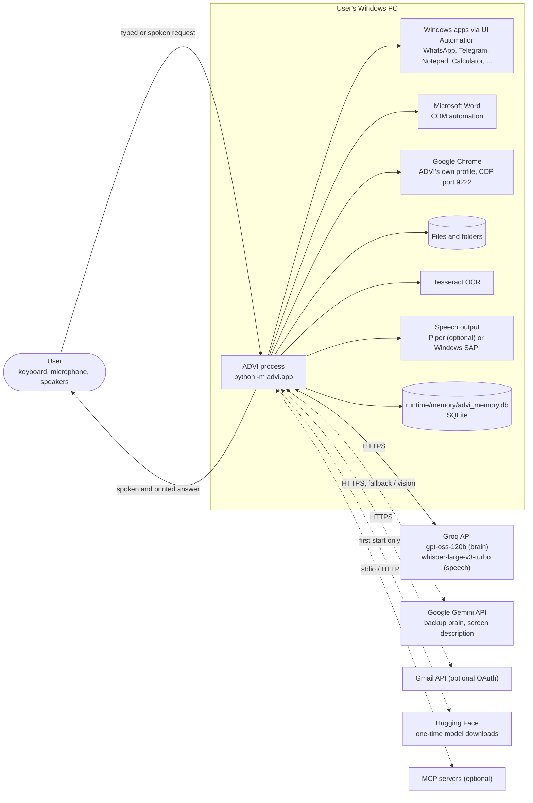
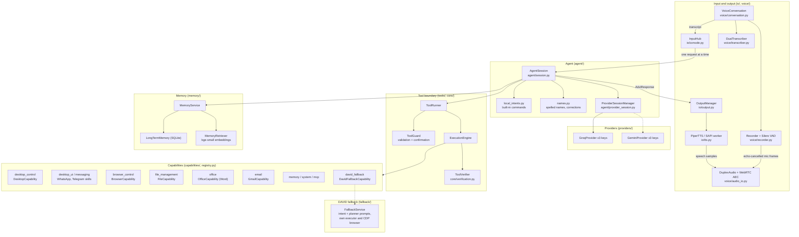
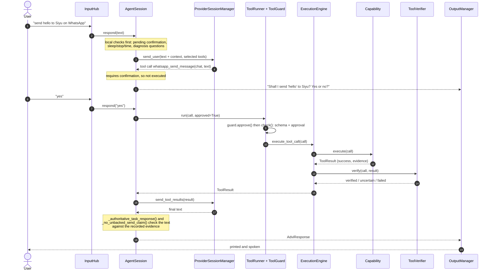
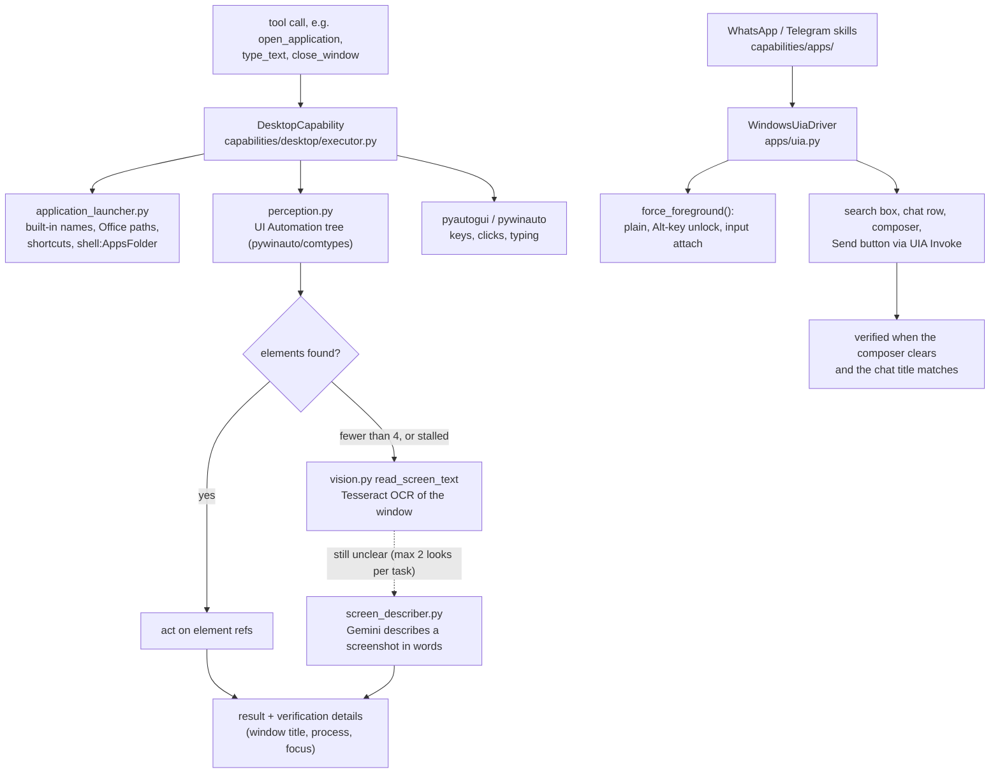
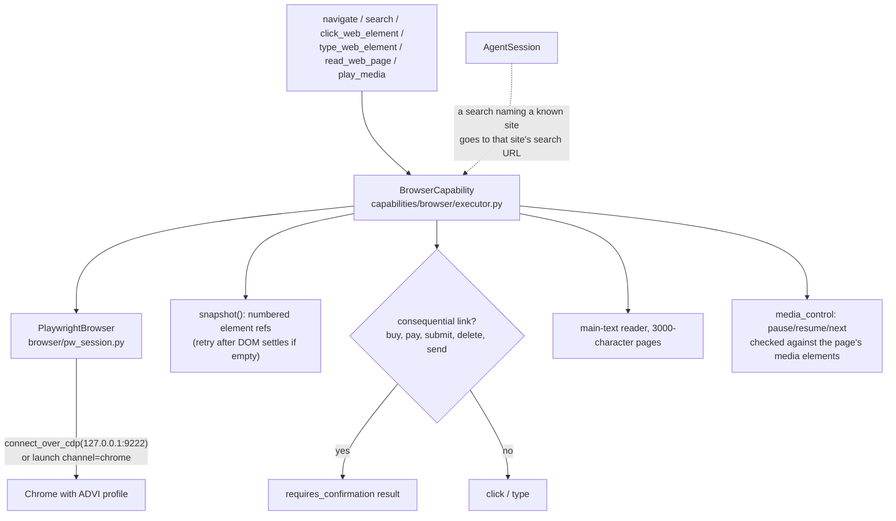
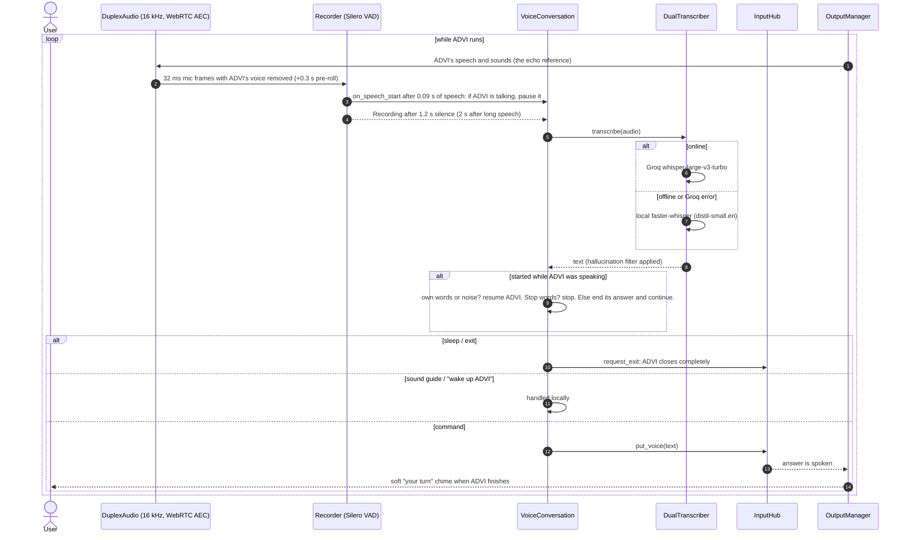
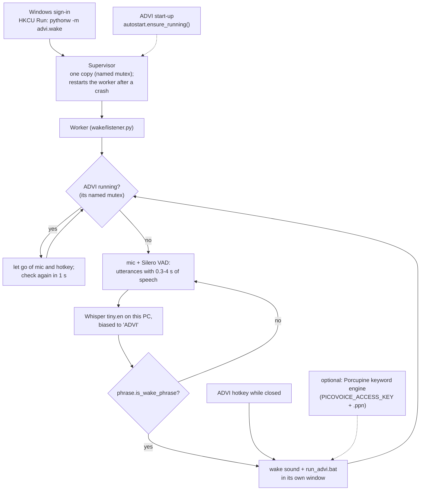

# ADVI architecture

This page describes the architecture as it is implemented in `src/advi/` (version 0.4.0). Every box in the
diagrams is a real module or class; dashed lines mark optional or conditional paths. The full narrative,
with design rationale and test evidence, is in [ADVI_TECHNICAL_REPORT.md](ADVI_TECHNICAL_REPORT.md).

**The rule the code follows:** the language model decides *what* to do. ADVI's own code owns the computer,
the task state and the evidence.
- The model only ever proposes a tool call.
- `ToolGuard` validates the call and enforces confirmation for sends, deletes of mail and similar actions.
- A capability performs the action.
- `ToolVerifier` and the capability's own read-back decide whether it really happened.
- `AgentSession` refuses to let the model's prose claim more than that evidence shows.

Each of these is a code path with tests, not just a prompt instruction. Section 7 of the report lists where
the rule is only partly enforced.

## 1. System context

## 2. Components

The wake listener (`src/advi/wake/`) is a separate process, not part of this diagram; see section 6.

## 3. One request, end to end

If every provider fails, `AgentSession._local_fallback()` tries a built-in command from
`local_intents.py` (open an app, a site search, play/pause, simple file moves, a message that still needs
a "yes"), and otherwise says plainly that the request needs the AI.

## 4. Desktop interaction

Vision returns a description in words only; it never supplies click coordinates and is never used as proof
that an action succeeded (`docs/audits/PHASE9_VISION.md`).

## 5. Browser interaction

## 6. Voice interaction

### The wake word (a separate process)

## 7. Fallback and recovery

```mermaid
flowchart TB
    subgraph prov["Provider failover (agent/provider_session.py)"]
        p1["groq-1"] -- "429 / timeout / 5xx" --> p2["groq-2"] --> p3["groq-3"] --> g1["gemini-1..3"]
        g1 -- "all failed" --> lf["_local_fallback(): built-in command<br/>or a plain 'this needs the AI' answer"]
        short["short per-minute limit (under 25 s):<br/>wait once, retry"] -.-> p1
    end
    subgraph tool["Tool failure recovery (agent/session.py)"]
        fail["native tool failed"] --> obsv["_capture_native_recovery_observation()<br/>UIA / OCR / bounded vision look"]
        obsv --> model["model chooses the next step"]
        fail -- "tool in the recoverable set,<br/>or Gmail API recommends fallback,<br/>or user said 'use David'" --> avail["task.context fallback_available"]
        avail -.-> dtool["david_fallback tool offered to the model"]
        dtool -.-> davidsvc["FallbackService (fallback/)<br/>own planner, executor, perception, CDP browser"]
        davidsvc -. "ToolResult; verified by DAVID's own loop" .-> model
    end
```

DAVID is a separate, isolated subsystem. It is never on the primary path: the primary model can only reach
it through the `david_fallback` tool, which is offered only in the three situations above.

## 8. Setup and testing

```mermaid
flowchart LR
    clone["clone or download"] --> setup["SETUP_ADVI.bat<br/>runs scripts/setup_windows.ps1"]
    setup --> venv[".venv with Python 3.13<br/>pip install -e .[dev]"]
    venv --> envf[".env created from .env.example"]
    envf --> model["offline speech + wake-word models<br/>(non-fatal)"]
    model --> checks["Piper / Tesseract / Chrome checks"]
    checks --> tests["compileall + pytest<br/>(live Groq test skipped)"]
    tests --> wake["wake listener registered<br/>at Windows sign-in"]
    wake --> key["user adds GROQ_API_KEY<br/>and/or GEMINI_API_KEY"]
    key --> run["run_advi.bat"]
    run --> ready["'Everything is ready'<br/>startup health check passed"]
    ready --> optional["optional: smoke_windows.ps1,<br/>benchmarks (benchmarks/README.md)"]
```

## Where things live

| Folder | Contents |
|---|---|
| `src/advi/app.py` | Process entry point: builds every component, runs the input loop, shuts down |
| `src/advi/agent/` | `AgentSession` (the task loop), provider session management, built-in commands, name handling |
| `src/advi/providers/` | Groq and Gemini clients behind one `LLMProvider` interface |
| `src/advi/tools/` | `ToolRegistry`, `ToolGuard`, `ToolRunner`, `ToolCall` / `ToolResult` contracts |
| `src/advi/core/` | Execution engine, verification, action contracts, strategy, health checks, logging, config |
| `src/advi/capabilities/` | Everything that touches the computer: desktop, browser, files, office, apps, gmail, memory, system, mcp |
| `src/advi/voice/` | Always-on listening, echo-cancelled duplex audio, speech recognition, hotkey, earcons, output level meter |
| `src/advi/wake/` | The wake-word listener process: phrase matching, engines, supervisor, start at sign-in |
| `src/advi/io/` | Console input hub, output manager, speech output |
| `src/advi/memory/` | SQLite long-term memory, embeddings retriever, experience lessons, session consolidation |
| `src/advi/fallback/` | DAVID, the isolated fallback planner and executor |
| `src/advi/environment/` | Known Windows folders, file-system watcher |
| `benchmarks/` | Desktop Suite, capability sweep, WebVoyager sample harness |
| `tests/current/` | Test suite (963 tests at the time of writing) |
